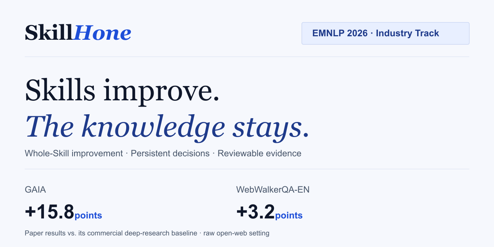
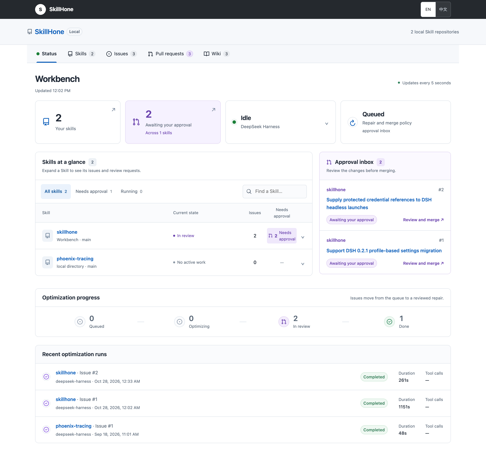

# SkillHone

**Continually improve complete Agent Skills — and keep what was learned.**

[Project website](https://zwlijay.github.io/SkillHone-Project/) · [中文介绍](README.zh-CN.md) · [Source code](https://github.com/Tencent/SkillHone) · [Paper](https://aclanthology.org/2026.emnlp-industry.105/)

## Get started

Give your coding Agent this prompt:

> Install SkillHone from `https://github.com/Tencent/SkillHone`, following
> `docs/install/skillhone.md`. Make the CLI and Skills available to this Agent,
> use the documented `--install-links=true` Git installation command, and
> verify the installation.

[Installation guide](https://github.com/Tencent/SkillHone/blob/main/docs/install/skillhone.md) · [Public repair example](https://github.com/Tencent/SkillHone/tree/main/examples/phoenix-tracing)

An Agent encounters a missing script, a broken reference, or an outdated API. SkillHone connects that evidence to a repair of the **complete Skill repository**, preserving the diagnosis, revision, evidence and outcome for the next session.

- **Whole-Skill improvement:** revise `SKILL.md`, scripts, references, assets and tests together.
- **Persistent decision history:** retain what each attempt taught, including rejected alternatives.
- **Evidence you can review:** inspect local Issues, regression tests, repair runs, PRs and linked Wiki records.

## See how it works

https://github.com/user-attachments/assets/69bafb25-5ba9-44cb-b5ff-8a2a94f8e51a

**Report → reproduce → repair → review → remember.** Runtime maintenance starts from a reproducible failure. Evaluation-driven optimization starts from a frozen evaluator in a separate repository. Both preserve evidence and decisions alongside the proposed improvement.

Inspect the development workbench

Actual local repair records. Local PRs belong to the Skill repository on your computer. Review is the default; automatic local merge is opt-in, and pushing is a separate user-authorized action.

## Built with open source

| Component | Role in SkillHone |
|---|---|
| [DeepSeek Harness](https://github.com/deepseek-ai/deepseek-harness) | Repair executor for the runtime maintenance workflow |
| [Node.js](https://github.com/nodejs/node) and its built-in SQLite API | CLI, local HTTP server, and persistent Issue / PR / Run / Wiki records |
| [Git](https://github.com/git/git) | Isolated repair branches, commits, diffs and local merges |
| [PyYAML](https://github.com/yaml/pyyaml) | YAML metadata parsing for the bundled Python quality checks |
| [Primer Octicons](https://github.com/primer/octicons) | Issue, PR, repository and Wiki icons in the workbench |
| [TypeScript](https://github.com/microsoft/TypeScript) | Development and build toolchain |

The workbench uses browser-native HTML, CSS and JavaScript. See
[third-party notices](https://github.com/Tencent/SkillHone/blob/main/THIRD_PARTY_NOTICES.md) and the [Harness integration](https://github.com/Tencent/SkillHone/blob/main/docs/deepseek-harness.md).

## Published research

**Accepted at EMNLP 2026 Industry Track.** The paper reports the following average benchmark scores:

| System and setting | GAIA | WebWalkerQA-EN |
|---|---:|---:|
| Commercially backed deep-research baseline, with its search stack | 48.8 | 63.2 |
| SkillHone, raw open-web setting | **64.6** | **66.4** |
| Improvement in percentage points | **+15.8** | **+3.2** |

SkillHone runs without a pre-integrated search stack. These figures belong to the paper's evaluation settings and baselines. See the [paper](https://aclanthology.org/2026.emnlp-industry.105/) and [full results](https://zwlijay.github.io/SkillHone-Project/#results) for the comparison, transfer experiments and ablations.

> Zhiwei Li and Yong Hu. 2026. *SkillHone: A Harness for Continual Agent Skill Evolution Through Persistent Decision History.* Proceedings of EMNLP 2026: Industry Track, pp. 1819–1829.

[Download BibTeX](static/skillhone.bib) · [CITATION.cff](CITATION.cff)

## About this repository

This repository hosts the static project website on GitHub Pages. The CLI, bundled Skills and runtime implementation live in [Tencent/SkillHone](https://github.com/Tencent/SkillHone).

To preview the website, serve this directory with any static HTTP server and open `index.html` or `zh.html`. Both pages share `static/css/site.css` and `static/js/site.js`. Website source is available under the [MIT license](LICENSE). Bundled fonts retain their [Open Font Licenses](static/fonts/); the paper is cited separately.
