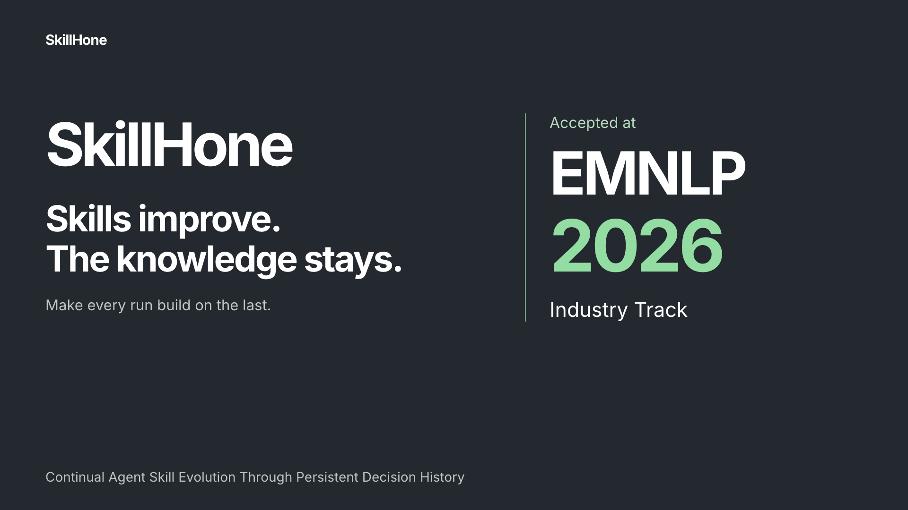

# SkillHone

**让完整的 Agent Skills 持续变好，让学到的经验留下来。**

[项目官网](https://zwlijay.github.io/SkillHone-Project/zh.html) · [English](README.md) · [源代码](https://github.com/Tencent/SkillHone) · [正式论文](https://aclanthology.org/2026.emnlp-industry.105/)

SkillHone 是一个持续改进 Agent Skills 的框架。Agent 在真实任务中遇到脚本缺失、引用失效或 API 变化时，SkillHone 把这些证据连接到完整的仓库修复，并保留诊断、修订、证据与结果，供后续 Agent 和会话继续使用。

- **优化完整 Skill**：说明、脚本、参考资料、资源与测试放在同一个 Git 变更中。
- **积累决策历史**：保留每次尝试学到的经验，以及被否决方案背后的原因。
- **连同证据一起审阅**：通过本地 Issue、回归测试、Run、PR 和 Wiki 追踪修复。

## 先看一次完整过程

[观看／下载 35 秒介绍](https://github.com/zwliJay/SkillHone-Project/releases/download/media-2026-10/skillhone-overview.mp4)。视频通过外部 Release 附件托管，仓库不存放视频或 GIF。

**报告问题 → 复现故障 → 执行修复 → 审阅变更 → 保留经验。**

运行时维护从可复现故障开始；评估驱动优化从独立仓库中的冻结评估器开始。两条路径都保留优化证据和决策过程。

展开查看开发版工作台

截图使用真实本地记录。本地 PR 属于你电脑上的 Skill 仓库。默认先审阅；自动本地合并需要主动开启，push 是用户单独授权的操作。

## EMNLP 2026 Industry Track

论文已被 **EMNLP 2026 Industry Track** 接收。论文报告的主要实验平均准确率如下：

| 系统与设置 | GAIA | WebWalkerQA-EN |
|---|---:|---:|
| 商业 Deep Research Agent 基线，保留其检索栈 | 48.8 | 63.2 |
| SkillHone，原始开放网络设置 | **64.6** | **66.4** |
| 准确率提高 | **15.8 分** | **3.2 分** |

SkillHone 无需预先集成搜索栈。上述结果对应论文中的设置与基线；完整实验、跨模型迁移和消融分析见[正式论文](https://aclanthology.org/2026.emnlp-industry.105/)与[实验页面](https://zwlijay.github.io/SkillHone-Project/#results)。

> Zhiwei Li and Yong Hu. 2026. *SkillHone: A Harness for Continual Agent Skill Evolution Through Persistent Decision History.* EMNLP 2026 Industry Track, pp. 1819–1829.

[下载 BibTeX](static/skillhone.bib) · [CITATION.cff](CITATION.cff)

## 开始使用

查看[源代码仓库的安装指南](https://github.com/Tencent/SkillHone/blob/main/docs/install/skillhone.md)，或跟着 [Phoenix tracing 公开案例](https://github.com/Tencent/SkillHone/tree/main/examples/phoenix-tracing)复现一次修复。安装文档覆盖 Codex、Claude Code、Cursor、Pi 和 ZCode，其他能够调用 CLI 的 Agent 也可以使用同一工作流。DeepSeek Harness 是可选的修复执行器。

## 这个仓库放什么

本仓库托管 GitHub Pages 项目官网；CLI、内置 Skills 和运行时实现位于 [Tencent/SkillHone](https://github.com/Tencent/SkillHone)。

使用静态 HTTP 服务器预览 `index.html` 或 `zh.html`。两种语言共享 `static/css/site.css` 与 `static/js/site.js`。网站源代码使用 [MIT 许可证](LICENSE)；字体保留各自的 [Open Font License](static/fonts/)，论文单独引用。
